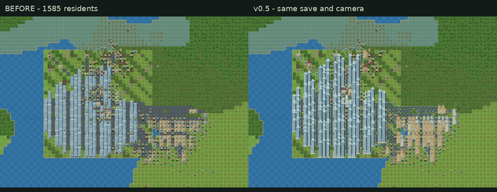
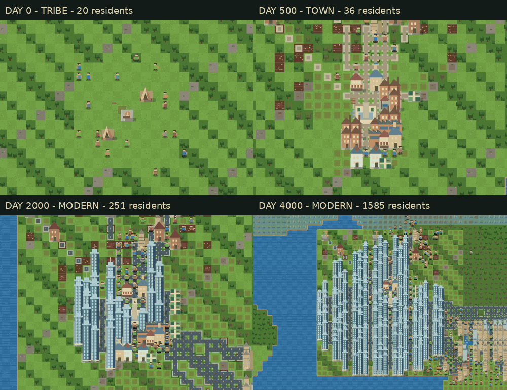

# 微型文明 · Mini Civilization

一个中文交互式**文明演化模拟器**：20 人在 256×256 大陆建立部落，通过农业、研究与工业发展为现代城市。保留旧版 64×64 自由沙盒与首年生存挑战。模拟逻辑与渲染分离，纯本地运行，无云端依赖。

## v0.6.1 · 按需成长与有效政策（本地重构）

本轮围绕 v0.6 新玩法的实际效果改造规划、配工与观察反馈，保留地块模拟和现有美术。

- **建设读同一份需求账**：每落一个项目重新计算需求，已排队住房也计入容量；工业与住宅在本轮内同样保持隔离。农田按真实产能估算需求，公园用地也有数量上限。道路按本地人口预留有限用地，城际通道单独按预算修筑、扣料，必要时建桥。
- **新聚落可以独立起步**：先取得自己的住宅和农田；选址不会覆盖已被主城占用的地块。人口在出生、死亡、迁入后统一重新分布，地块、聚落与全局数字一致。
- **政策有可测的效果**：粮食政策提高产能与储备目标；有余粮时农业释放劳动力给学校、工业和服务。研究提高学校优先级及知识产出；宜居提高公园和诊所的规划权重。需求已满足时，扩张政策也不会强行重复划区。
- **建设效果与反馈一致**：公园分区落成后计入本地覆盖和地价；电力区分实际发电与装机容量，燃料消耗写入当日流量。住房等级受时代限制。“发展观察”展示约束、政策作用、在建住房与下轮规划时间。
- **续档保持同一路线**：建筑美术使用独立随机数，重画不消耗人口模拟的随机序列；载入即重建岗位，并保留政策和图层。沿用 v4 格式及原存储键，自由沙盒和首年生存继续保留。

2026-10-16 本机验证：**113 项常规测试通过**，2 项可选长测默认跳过；另跑种子 42 的 **24000 天长测**，到达现代都市、35094 人、6 个连通聚落。种子 42 / 777 / 2026 各跑 12000 天，均到工业城市，3 个聚落均有人口且连通；各自在第 5632 天保存，恢复后继续 200 天，与连续运行的完整持久状态一致。政策对照从同一份存档跑一年：均衡 / 粮食日均产粮 73.5 / 91.2，均衡 / 研究日均知识 14 / 21，宜居公园 1→2；这些是本机游戏参数的结果。

同种子 42、12000 天：v0.6 对照为 104 个已开发地块、29 块农田，第二聚落 0 人；重构后为 70 个已开发地块、8 块农田，3 个聚落人口为 1635 / 136 / 54。两版总人口分别为 1930 / 1825；本轮目标是改善规划和反馈，并非提高人口增长率。

边界：聚落资源仍用全局账本，S4 的独立转运未实现；居民仍是动画采样。极长局仍可能用满地图，24000 天样本已有 534 个公共设施地块、供电约 69%，后期土地与公共设施密度仍有进一步平衡空间。实体手机未测。本轮为本地交付，尚未推送或发布。

重跑场景：`npm run verify:plot -- <本地输出目录> 12000 42,777,2026`。会生成指标、可恢复存档与跨读档一致性结果；输出默认位于被忽略的 `output/plot-scenarios/`。

## v0.6 · 地块级文明（重写）

「大陆文明演化」模式的模拟核心重写为**地块级**：城市形态不再由"到地图中心的距离"决定，而是由**路网 + 分区 + 服务覆盖 + 地价**决定。旧 v0.3 / v0.5 文明存档不能继续（读取时会明确提示）；自由沙盒与首年生存不变。

- **地块账本**：世界仍是 256×256 瓦片，模拟单位改为 8×8 瓦片的**区块**（32×32 = 1024 块）。人口、岗位、住房、服务覆盖、地价、污染、在建项都记在区块上。居民按人口比例生成为动画采样（不再逐个模拟），所以人口上限从 1800 提升到数万。
- **道路是区块之间的边**：规划器先铺路，住宅 / 工业 / 公共 / 公园地块**必须临路**；农业地块允许不临路，但产出按"到最近仓储的路网距离"打折。跨水要造桥、山地必须绕行，城市形状因此被地形塑造。
- **自动规划器**：每 5 游戏日跑一轮「选址 → 路网 → 分区 → 公共服务 → 升级」。工业地块不得与住宅相邻；住房是否升级由**本地地价**与城市入住率决定，不再看全局人口数；人口足够时向外建立新聚落（最多 6 座，都市带的前身）。
- **政策滑杆**：均衡 / 粮食 / 扩张 / 研究 / 宜居，改变规划器权重与产出系数（不新增分支逻辑）。
- **时代门槛换成城市形态指标**：农业聚落＝≥6 个农业地块 + 仓储 30 天口粮；繁荣城镇＝路网 60 边 + 市场覆盖住宅 70% + 平均等级 2 + 知识 800；工业城市＝工业与住宅零相邻 + 电力覆盖 90% + 累计钢材 2000；现代都市＝高地价住宅 16 块 + 两座连通聚落。满足条件后自动跨时代，快进仍可以在自动规划下达到现代都市。
- **图层**：分区 / 服务覆盖 / 地价 / 污染 + 缩略图；点击地块可看人口、地价、物流系数与服务覆盖。
- **存档 v4**：压缩保存，区块只存不可推导字段，载入后重算覆盖 / 地价 / 物流与建筑描述符。旧文明档（v3）拒绝加载并给出提示，沙盒与首年档继续兼容。
- **实测**（2026-10-16）：种子 186590225 跑到第 173 年、2.8 万人 / 823 个已开发地块，200× 仍是 165 FPS、实速 200×；长测（种子 42，12000 天）达成工业城市、2194 人、2 座聚落，单 tick 平均 0.011 ms。对照组 v0.5：1448 人时实速只剩 38.7×、人口硬顶 1800。
- **已知边界**：新聚落要等上一座长到 12 个地块才开始发育，卫星城早期可能只有广场与农田；「现代都市」一般要到第 40–60 游戏年；模拟参数仍未按现实人口数据校准。

## v0.5 · 可见的城市成长与快进性能

- **时代轮廓**：帐篷 → 木屋 → 砖房 → 成排公寓 → 高低错落的玻璃高楼；学校、诊所、市场、粮仓、工厂和电站分别绘制。中心篝火在城镇阶段形成广场，工业阶段增加钟楼；旧宅改建显示吊架。
- **城市镜头**：默认跟随居住城区，随扩张平滑调整取景；拖动、缩放或小地图定位会退出跟随。可随时切回跟随、全城总览或整片大陆。旧文明存档直接使用新画风和跟随镜头，无需重开。
- **快进响应**：交货仓库列表缓存，最近仓库由线性查找选出；建筑仅在增减时排序，静态建筑精灵缓存上限约 4MiB；镜头外实体不绘制，远景居民抽样为点，人物按位置与建筑正确遮挡。界面每帧给模拟约 5ms 的计算预算，设备跟不上时实际速度降低，显示 FPS 和实际 / 目标倍速。单个过慢 tick 仍可能超过预算。
- **实测边界**：同一约 1600 人存档，200 次预热后推进 2000 tick，采样耗时约 5.69s → 1.55s（约 3.7 倍），2200 tick 后完整状态一致。数字来自开发运行环境，不能代表手机帧率。
- **验证**：69 项常规测试、生产构建，以及种子 42 的 4000 天长测。长测仍为 1585 人 / 303 建筑；模拟结果没有因画风和查找算法改变。





性能复测可使用 `npm run benchmark -- /absolute/path/to/save.json 2000`。纯 JSON 存档可通过长测生成：`CIVILIZATION_LONG=1 CIVILIZATION_CHECKPOINT=/tmp/city.json npm test -- tests/civilization-long.test.ts`。

## v0.3 · 从原始部落到现代都市

新增 **大陆文明演化** 模式：默认新局进入此模式。已有沙盒 / 首年挑战存档保持原模式，先保存再点“新建大陆文明演化”进入新地图。

- **地图**：256×256（旧地图面积的 16 倍），草原、森林、湖泊 / 河流、矿区、沙漠、雪地、湿地、丘陵、山地；农田由居民开垦。水域与山地不可通行。
- **时代**：原始部落 → 农业聚落 → 繁荣城镇 → 工业城市 → 现代都市。升级检查建成设施、知识、人口、钢材与供电率，不能只等天数。住宅需要施工升级，帐篷 / 木屋 / 砖房 / 高层楼体逐步替换。
- **城市内容**：篝火、水井、工坊、粮仓、农舍、集市、学校、诊所、公园、采石场、工厂、发电站和现代高楼。道路在建筑落成时修建并扣石料，居民沿路移动更快。城市持续向外扩张；集市与粮仓分担交货地点。
- **产业**：研究人员在学校积累知识；工人在工厂消耗木石、依赖电力生产钢材；采石场由矿工开采有限地下矿藏。工业时期的电力推动农田机械化，停电会影响农业与工业产能。
- **人口**：游戏历 365 天 / 年，18 岁成年；女性 18–42 岁、存在成年男性、营养与住房合适时才可能妊娠；妊娠 270 天、产后至少间隔 2 年。未成年人口不工作。迁入每 30 天检查岗位、住房、安置粮食及有限的外部人口池，并单独计账。不是按固定 tick 强行加人。
- **观察与控制**：自主建设开关、粮食 / 扩张 / 研究 / 均衡优先级、下一时代条件、小地图点击导航、城市总览、大陆总览，1×–200× 快进。
- **存档**：v3 压缩存档降低大地图的浏览器存储占用；继续接受 v1 / v2。自动与手动存档仍独立，数据只在当前浏览器。

本轮做的是千人级个体模拟与大规模城区。人口、资源和科技参数是游戏模型，未经现实人口数据校准；五个时代也不对应真实历史年表。为了保留逐个居民的行为，迁入在 1800 人附近受模拟规模约束；不宣称逐人模拟现实百万都市。

验收（2026-10-13）：64 项测试通过，含 4000 天实际演化。种子 42 最终为现代都市，1594 人、304 座建筑，人口账为初始 20 + 出生 204 + 迁入 1370 − 死亡 0。该结果只代表已测种子和参数，不保证所有地图或实机性能。

普通回归：`npm test`。长程演化测试单独开启（较耗时）：

```bash
CIVILIZATION_LONG=1 npm test
```

Windows PowerShell：先执行 `$env:CIVILIZATION_LONG='1'`，再执行 `npm test`。长测默认 4000 天，检查时代解锁、千人城市、人口来源恒等式、道路、功能建筑与存档；通常 CI 跳过这项长测，保留机制测试。

## v0.2 · 撑过第一个冬天

点击 **新建首年生存挑战** 可进入此模式，开局暂停，先安排村庄，再点击开始。旧存档保持原模式恢复；v0.3 新玩家默认进入大陆文明演化。所有模式都不需要账号。

- **目标**：一年 120 天、每季 30 天；年末至少存活 20 人。默认 2×，模拟时长约 6 分钟，事件会暂停等待选择。
- **分工**：农夫采收食物；建筑工施工，无工地时采木石；剩余采集者负责木材和石头。幼儿不工作。
- **季节**：冬季食物消耗 +40%，采收效率降至 30%，草地和农田再生减慢。显示入冬倒计时、储粮上限与现有口粮的冬季覆盖天数。
- **建设**：住房（30 木 +15 石）增加 4 人容量；粮仓（45 木 +20 石）增加 900 储粮容量；农舍（40 木 +10 石）增加农田采收与再生 25%，最多 75%；农田（5 木）需要建筑工开垦。最多 4 个工地同时排队。
- **决策事件**：第 18 天的难民、第 48 天的粮商、第 78 天的远行。展示真实成本和住房要求，资源不足会禁用选项。远行可以放弃，避免零资源时锁死。
- **结算**：存活人口、饿死 / 老死、最低储粮、剩余粮食及关键选择；可用同一种子再试或继续发展。
- **手机**：拖动地图、双指缩放、44px 主要控件、原生模态决策弹窗；职业服色、建筑标识、四季色调与冬季飘雪。
- **存档**：每 5 秒自动保存；切后台时保存；手动存档独立，读取不会被自动保存覆盖。兼容 v1 沙盒存档，保留暂停和未处理事件。存档只在当前浏览器，不跨设备同步。
- **辅助补给**：仍可 +50；使用后标记为辅助局，结算不冒充无补给成绩。

开局可先安排 12–13 名农夫与 2 名建筑工，开垦近村农田，再建设粮仓和农舍。不要只扩住房：人口增加也会增加冬季口粮消耗。覆盖天数是**不含未来采收**的保守估算，不能保证一定生存。

自由沙盒继续保留自动建设、自动开垦及原随机事件。首年挑战的选择事件仅在第一年发生；暂未加入关系、战争、科技树与贸易系统。

## 启动命令

Windows 可直接双击 **`Start-Game.cmd`**：首次构建并在后台启动本地预览，再打开游戏；再次双击会打开已运行的服务。默认地址为 `http://127.0.0.1:4180/mini-civilization/`，运行日志在被忽略的 `runtime.local/`。需要本机 Node.js 与 npm。

```bash
npm install     # 安装依赖（首次）
npm run dev     # 开发预览 → http://localhost:5173
npm test        # 自动化测试（含首年机制、五种地形平衡及旧版回归）
npm run build   # 类型检查 + 生产构建 → dist/
npm run preview # 预览生产构建
```

## 部署为公网网址（手机可打开）

项目是纯静态前端，部署即得永久网址。仓库已内置 GitHub Actions 工作流（`.github/workflows/deploy.yml`）：**push 到 `master` 自动测试、构建并部署**。

首次部署两步：

1. 仓库 **Settings → Pages → Source** 选 `GitHub Actions`（只做一次）。
2. push 代码后等 Actions 跑完（约 1 分钟），网址：

```
https://<你的用户名>.github.io/mini-civilization/
```

- **手机**：浏览器直接打开上述网址即可玩，窄屏已适配（地图在上、操作栏在下）。
- **本地验证生产路径**：先运行 `npm run build -- --base=/mini-civilization/`，再运行 `npm run preview -- --host 127.0.0.1 --port 4180 --strictPort --base=/mini-civilization/`；构建与预览使用相同子路径。
- **存档**：每个设备/浏览器的 localStorage 独立，手机与电脑存档互不相通。
- **长久性**：静态托管无过期机制；源码与构建均在本地 git，随时可换托管商重新部署（换家 5 分钟，网址可变、游戏不丢）。
- 后续更新：改完代码 `git push` 即自动更新线上版本。

## 操作说明

| 操作 | 方式 |
| --- | --- |
| 平移地图 | 鼠标拖动 |
| 缩放 | 滚轮（以光标为中心） |
| 查看居民 / 格子 | 点击（详情在侧栏展示，再次点 × 取消） |
| 开始 / 暂停 | 侧栏按钮或 **空格** |
| 模拟速度 | 1× / 2× / 5× / 10× / 20× |
| 重置世界 | 输入种子后点「重置世界」（留空 = 随机种子） |
| 手动补充资源 | 资源行右侧 **+50** |
| 开垦农田 | 点击草地格 → 详情面板「开垦为农田（木材 −5）」 |
| 存档 | 保存存档 / 读取存档（localStorage，刷新页面自动恢复上次存档） |

## 已完成功能（对照任务书）

- [x] **世界生成**：64×64、草地/森林/水域/石地四地形、双八度噪声 + 分位数分类、种子可复现、可重置
- [x] **居民系统**：20 人初始、饥饿/体力/年龄/任务四要素、A* 寻路（含直线拉直）、移动动画、自动决策（进食/休息/采集/交库/建设/散步）、饥饿与年老致死、条件满足时出生、**饥饿生存中断**（长途任务中会立即打断去吃）
- [x] **建设系统**：材料达标自动落位工地、真实消耗 30 木材 + 15 石头、居民施工至落成、住房 +4 人口容量且加速休息
- [x] **经济与生态**：食物/木材/石头三资源闭环、草地与森林有限再生（石头不可再生）、人口压力 → 资源短缺 → 饥饿危机的传导
- [x] **交互系统**：开始/暂停/重置、三档倍速、点选居民与格子、手动补给、拖动平移与滚轮缩放
- [x] **UI 与视觉**：全中文、地图主视觉、墨绿夜色 + 羊皮纸 + 琥珀强调的独立游戏风格、居民行走/进食/休息/施工动画、水面微光、住房与工地清晰可辨、侧栏人口/资源/时间、**实时历史统计曲线**（人口/食物/木材/石头）
- [x] **纪事系统**：侧栏日志实时记录**里程碑**（首座房屋、人口 30/50、第 100 天、住房 5 座、累计出生 10）与**随机事件**（丰收、蝗灾、狩猎队、新石脉、旅人来访），带时间戳、最新在前
- [x] **足迹成路**：居民走过的格子累积踩踏，密集处渐变为土路——聚落道路网随游戏进行自然「长」出来
- [x] **农田开垦**：选中草地详情页可花 5 木材开垦为农田——存量上限 60、再生 ×3、居民**优先采集**（距离加权）；首次开垦记入纪事；中央广场保留区不可开垦。**居民也会自动开垦**：木材富余（≥55，不抢 30 建房料）且农田不足 12 块时自动立开垦工地，居民施工落成
- [x] **存档**：localStorage 完整状态序列化，恢复后继续模拟（非仅画面）

## 未完成 / 有意简化

- 历史曲线无悬停读数与时间轴刻度（图例显示末端值）
- 未做居民个性化（技能/职业/关系），任务书未要求
- 窄屏（<860px）采用地图在上、控制面板在下；支持双指缩放
- 按约束未做：联网、多人、大模型接入

## 已知问题

- 浏览器后台标签会节流 rAF；回到前台时单帧推进上限 0.25s，不会跳档
- 开发模式下 vite HMR 偶发「旧模块 + 新模块」混载（表现为按钮无响应），**重启 `npm run dev` 即可**；生产构建无此问题
- 人口较多时中心交粮点会出现居民视觉堆叠（已有错峰进食缓解）

## 历史测试与构建结果（2026-10-09，v0.1）

```
npm test       →  Test Files 8 passed (8) / Tests 28 passed (28)，约 7s
npm run build  →  tsc --noEmit 通过；vite build 通过（261 kB JS / 6.3 kB CSS）
npm audit      →  0 vulnerabilities
```

覆盖任务书要求的全部 7 类：同种子同地图、资源不为负、建筑不凭空产资源、死亡居民不行动、暂停不推进、存档恢复一致、**连续 10000 tick 无异常**（含不落水/不灭绝不变量）；另有 **真实开局长期食物平衡测试**（5 个种子 10000 tick：饿死 ≤2、人口不灭绝）。

开发过程中测试实际抓获并修复的真 bug：

1. **擦角落水**：路径拉直用整数 Bresenham 校验，与居民实际「格中心连线」经过的格集不一致 → 改为 Amanatides–Woo 浮点网格行走校验。
2. **食物经济崩盘**（玩家反馈「过几天饿死」）：根因是进食占用任务槽（打断采集浪费行程 + 库存击穿后「吃-交」互锁）。重构为 **tick 层「边干边吃」涓涓流**——越过个人阈值才吃 1 口、自动节流、不打断任务不丢路径，配合采集效率（携带 16 / 移速 0.18）与错峰阈值；压力下饿死数从每种子 16~20 降为 **0**，并新增死因统计（饿死/老死分开核算）。

## 技术结构

```
src/sim/      模拟核心（纯数据，零 DOM 依赖，可单测）
  world.ts        种子世界生成（噪声 + 分位数地形）
  path.ts         A* + 直线拉直（浮点行走校验）
  simulation.ts   tick 状态机 / 经济 / 人口 / 建设 / 再生
  save.ts         存档序列化（可注入存储）
src/render/   渲染层（离屏地形缓存 + 实体层 + 相机）
src/ui/       React 侧栏与统计曲线
tests/        vitest 27 项用例
```

技术栈：React 19 + TypeScript + Vite 6 + Canvas 2D + vitest 5。外部依赖仅 React（开发依赖 vite/vitest）。
